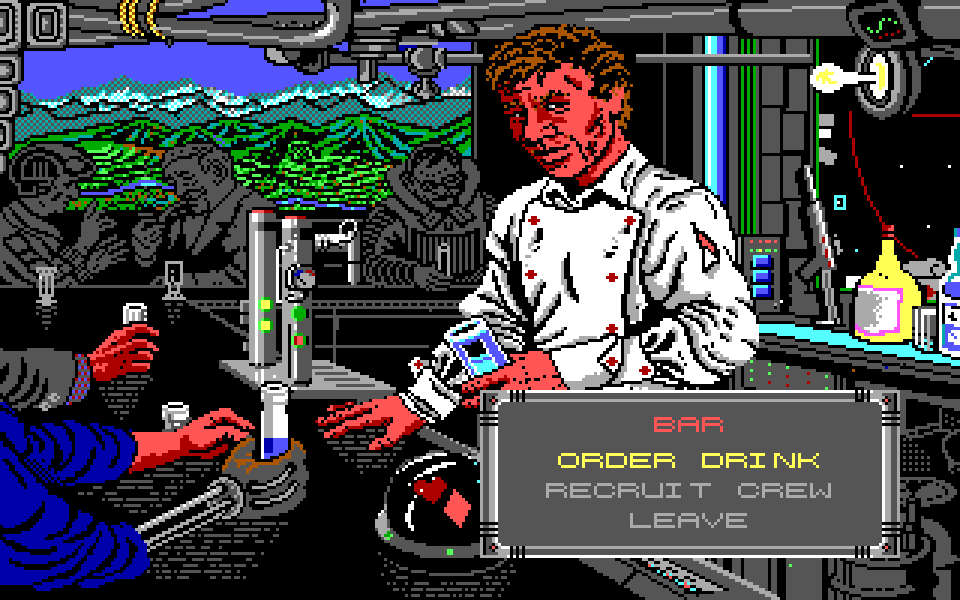
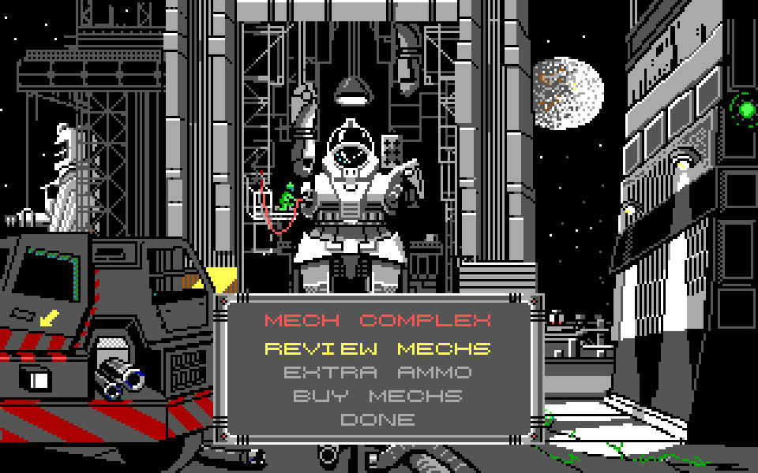

# MechWarrior 1 Rebuild (mech1-re)

A rebuild of **MechWarrior** (Activision, 1989, developed by Dynamix) as a modern C++ program, so the game runs on
today's Windows, macOS and Linux. It is built on **[Elthial's MechWarrior SDL port](https://github.com/Elthial/Mechwarrior-sdl-port)**,
the readable reconstruction of the original program.

| Combat cockpit | Bar |
| --- | --- |
|  |  |
| **Star map** | **Mech complex** |
|  |  |

*The rebuild running with the player's own copy of the game. The art shown is the original game's and belongs to its
rights holders; none of its files are in this project.*

It is **not** an emulator or a patched copy of the original. The original program's logic is rebuilt function by
function, without emulating the old PC's sound, graphics or timer hardware. It is checked by automatic tests and against
recorded runs of this program itself; the original of 1990, run under DOSBox-X, gives the same frames and state in all
eight that were compared. What is checked and what isn't is in [the runtime status](docs/RUNTIME_STATUS.md). The aim is
for it to play as the original does.

**Status:** 1.0.2 is out for Windows, macOS and Linux on the
[Releases page](https://github.com/telltaleatheist/mech1-re/releases). What is known to differ from the original, and
what no one has played yet, is in its notes. Your own copy of the game is needed (below): the first start finds it or
asks you where it is.

## Your own copy of the game

The rebuild contains none of the original's files. It reads the pictures, maps, music, sounds and text from your own
copy of MechWarrior for DOS, so you need one to play: the 1989 release or the one of 1990-01-22
([which files that is](docs/SUPPORTED_VERSIONS.md)).

The first start looks for it on your computer, or lets you pick its `BTECH.EXE`, any file in its folder, or the archive
it came in. It copies the game into your own folder and plays from there. Your copy is never changed. If some of its
files are missing, damaged or unlike the ones this project knows, the setup says so and you can still go on.

## Playing

Arrows and Enter work the menus. In combat:

| Key | What it does |
| --- | --- |
| Up, Down | throttle |
| Left, Right | turn |
| Space, Tab | fire the selected weapon, fire all |
| Enter | target |
| C, D, E, Q | command, your damage, the target's damage, back to the cockpit |
| T, Z | map, zoom |
| P | pause |
| - and + | combat speed, 1x to 4x |

F12 saves a screenshot beside your saves, and Ctrl+Escape quits. Up to two game controllers work as the original's
joysticks. The window can be made any size, and the picture fills it at 16:10
([docs/WINDOW.md](docs/WINDOW.md)).

The music plays from a bundled soundfont. `music=` in `MechWarrior.ini`, in your own folder, changes it to the PC
speaker's (`speaker`) or turns it off (`off`); see [docs/AUDIO.md](docs/AUDIO.md).

Your settings (`MechWarrior.ini`), saves, the copied game and the log (`mechwarrior.log`) are in your own folder, and an
update or an uninstall leaves them alone:

| | |
| --- | --- |
| Windows | `%APPDATA%\BattleTech\MechWarrior 1 Rebuild` |
| macOS | `~/Library/Application Support/BattleTech/MechWarrior 1 Rebuild` |
| Linux | `~/.local/share/BattleTech/MechWarrior 1 Rebuild` |

The [BattleTech launcher](https://github.com/telltaleatheist/mech3-re) can install, set up, start and update it
too.

The original's copy protection is left out: the game never asks for it.

## This project and the game

This project is unofficial and non-commercial. It distributes none of the original's files. It is not affiliated with
or endorsed by the holders of any rights in MechWarrior or BattleTech. The [rights notice](docs/NOTICE.md) says more.

## Building

You need CMake 3.20 or later, a C++20 compiler and SDL3 3.2 or later (macOS: `brew install sdl3`). Once per machine:

    git submodule update --init
    tools/deps/fetch_soundfont.sh     # the music's soundfont, 135 MB
    tools/deps/build_archive.sh mac   # or linux: lets the setup read downloads (zip, 7z)

Then:

    cmake -S . -B build -G Ninja -DCMAKE_BUILD_TYPE=Release
    cmake --build build -j4
    build/mechwarrior

Windows and the rest are in [docs/BUILDING.md](docs/BUILDING.md), and packages in
[docs/RELEASING.md](docs/RELEASING.md). `mechwarrior --help` lists what it takes on the command line.

A run without a player has `SDL_AUDIO_DRIVER=dummy` set, and on Linux `SDL_VIDEO_DRIVER=offscreen`, on the Mac
`MW1O_HIDDEN=1` (a hidden window: macOS's offscreen driver has no renderer). The recorded runs the rebuild is checked
against are described in [tools/trace/README.md](tools/trace/README.md).

## Credits and licence

- **MechWarrior** was developed by Dynamix and published by Activision in 1989. All the game's content is theirs, or
  belongs to its rights holders, and comes from your own copy.
- **The reconstruction, its research and its tools are Elthial's work.** This is a fork of Elthial's MechWarrior SDL
  port, and it keeps the port's full history (the fork point is `e119a72a`), its [LICENSE](LICENSE), the
  [MIT text](docs/LICENSES/MIT.txt) and the [rights notice](docs/NOTICE.md). Elthial's README, as forked, is
  [docs/PORT_README.md](docs/PORT_README.md). The original port is at
  https://github.com/Elthial/Mechwarrior-sdl-port; fixes that belong in it are offered to Elthial there. Elthial's
  licence terms (MIT for the host code under `src/SDL` and `src/Support`; see
  [docs/LICENSES/README.md](docs/LICENSES/README.md) for the rest) apply to everything taken from it.
- It runs on [SDL3](https://www.libsdl.org/). The other libraries, the music's soundfont and their licences are in
  [the third-party notices](docs/THIRD_PARTY_NOTICES.md).

## Layout

- `src/Original/`: the game, in the original program's own parts: the campaign, combat, its renderer, sound and memory.
  Each function keeps the original's address.
- `src/SDL/`: the window, input, time and sound, on SDL3. `src/Setup/`: finding and copying the player's game.
- `src/Video/`, `src/Audio/`, `src/Import/`, `src/Rules/`, `src/Ui/`, `src/Support/`, `src/include/`: the rebuild's own
  canvas and sound, reading the player's copy, our data, and the headers.
- `data/`: our own rules, screen layouts and setup screen, which the game reads beside the program.
- `docs/`: the [guides](docs/README.md) to the game, its code and the project. The rebuild's plan is
  [docs/phase5/NO_EMULATION_PLAN.md](docs/phase5/NO_EMULATION_PLAN.md).
- `tools/`: packaging, the recorded runs and the study tools. They work on your own copy, and never publish it.
