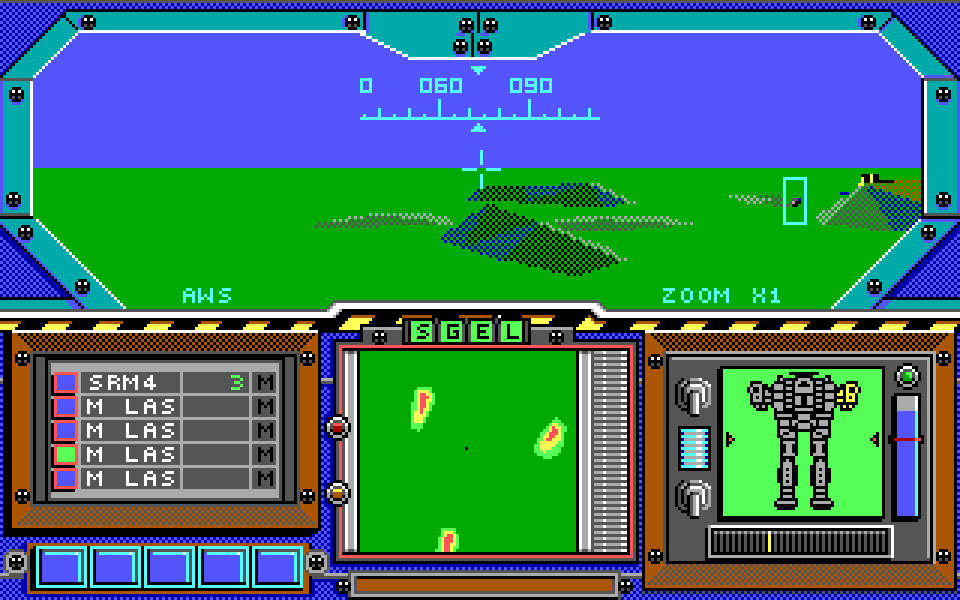
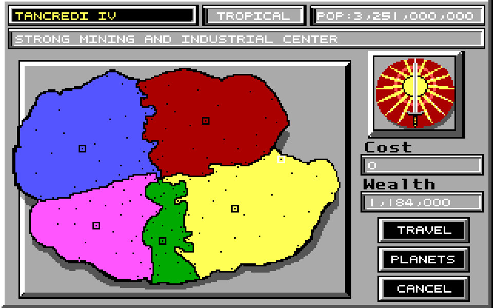

# MechWarrior 1 Rebuild (mech1-re)

This is a fork of **Elthial's MechWarrior SDL port**, the readable reconstruction of MechWarrior (1989) whose
README follows below. It keeps Elthial's full history (the fork point is `e119a72a`), their `LICENSE`, the MIT text and
the [rights notice](docs/NOTICE.md). The original port is at https://github.com/Elthial/Mechwarrior-sdl-port and is the
`upstream` remote here (fetch only).

**What we're doing with it:** rebuilding the 1989 game as a modern C++20 program, without emulating the old
PC's sound, graphics or timer hardware. Each function keeps the original's address. The game's creative content still
comes only from the player's own copy of the game. Every step is checked against recorded runs
of the game (`tools/trace`): the rebuilt game must replay each script exactly as the original logic does. The plan is
[docs/phase5/NO_EMULATION_PLAN.md](docs/phase5/NO_EMULATION_PLAN.md).

Fixes that belong in the port itself are offered to Elthial upstream separately. No release has been made yet; how a
package is built is in [docs/RELEASING.md](docs/RELEASING.md).

**To play** you need your own copy of MechWarrior (1989). The first start asks for it (its `BTECH.EXE`, its folder, or
the archive it came in), copies it into your own folder and plays from there. Your copy is never changed. The music
plays from a bundled soundfont, or as the PC speaker's, or not at all ([docs/AUDIO.md](docs/AUDIO.md)).

**Credit:** the reconstruction, its research and its tools are Elthial's work. Their licence terms (MIT for the host
code under `src/SDL` and `src/Support`; see `docs/LICENSES/README.md` for the rest) apply to everything taken from it.

| Combat cockpit | Bar |
| --- | --- |
|  |  |
| **Star map** | **Mech complex** |
|  |  |

## Where it is

- **C++20:** the sources are `.cpp` and build as C++20 (CMake, the only build; Visual Studio opens the folder as
  a CMake project).
- **Build (macOS, Linux):** `git submodule update --init` and `tools/deps/fetch_soundfont.sh` once, then
  `cmake -S . -B build -G Ninja -DCMAKE_BUILD_TYPE=Release && cmake --build build -j4`. SDL3 from the system (Homebrew
  on the Mac). The setup reads downloads (zip, 7z) only with libarchive: `tools/deps/build_archive.sh` builds it.
  Windows and the rest: [docs/BUILDING.md](docs/BUILDING.md).
- **Headless runs:** `SDL_AUDIO_DRIVER=dummy`; on Linux `SDL_VIDEO_DRIVER=offscreen`; on the Mac `MW1O_HIDDEN=1` (a
  hidden window: macOS's offscreen driver has no renderer).
- **Golden traces and the menu-handler map:** `tools/trace/README.md`, `docs/phase0/`.

---

*Elthial's README, as forked. It describes the port at the fork, so its status, sound and build notes are out of date
here: the sections above say how this program is now.*

<p align="center"></p>

# MechWarrior SDL port

A readable, assembly-loyal C17/SDL3 reconstruction of **MechWarrior (1989)**.
The aim is preservation: run the original game behaviour on modern hardware
and expose its interior—BattleMechs, weapons, pilots, contracts and renderer—for
education and research. This is not a redesign, remake or original asset pack.

**A legally obtained original game installation is required. No original game
executables or data files are distributed.** See [the rights notice](docs/NOTICE.md) and the
[licensing map](docs/LICENSES/README.md). This is an independent, unofficial project.

## Status

Experimental playable Windows x64 EGA/PC-speaker build, not a finished v1.0.
The real campaign/launcher chain reaches briefing, movement, firing and combat
return. Campaign travel, Bar/recruitment, contracts, Mech repair/rearm and trading
are connected. A local Support-pilot defence victory was recorded; that does not
certify the full campaign, all scenarios, adapters or audiovisual fidelity.
Combat runs at a fixed **60 ms per tick** at 1x, with the main-row `-` and `=` keys
for 2x to 4x ([game speed](docs/CPU_TIMING_PROFILE.md)).
Campaign music also supports [MT-32 and AdLib](docs/AUDIO.md), with user-provided
ROMs required for MT-32. Combat initializes the selected card but retains the
original speaker effects supplied by its sound bank.

See [runtime status](docs/RUNTIME_STATUS.md) for current gameplay limits.
Research tooling and verification suites are maintained separately in the
reverse-engineering repository, not bundled with this public game.

| Campaign planet hub | Combat gameplay |
| --- | --- |
|  |  |

[More real runtime captures and provenance](docs/SCREENSHOTS.md).

## Build and play

Requirements: Windows x64, Visual Studio C++ and CMake tools, PowerShell, and an
existing SDL3 package/source tree.
Dependencies are not silently downloaded.

```powershell
# Compile the platform-independent library without SDL or original game files:
./src/Build.ps1 -Headless -Configuration Release

# Supply your SDL3 installation (or use -SDLSourceDirectory):
./src/Build.ps1 -Configuration Release -SDL3Directory 'D:/Libraries/SDL3/cmake'

# Game data remains in your own installation:
./src/Run-MechWarrior.ps1 -GameDirectory 'D:/Games/MechWarrior'
```

Alternatively place private files in ignored `assets/original-game`. Saves and
F12 captures go to ignored local directories, not into the original installation.
On the first run the importer reads the game's exes once into a story file in
the save directory; from then on play opens only resource files, never an exe
(the program stops if anything tries). Copying just the TBL/BMP assets is
still insufficient for that first run. Keep SDL3.dll next to the built
executable. Visual Studio opens the repository folder as a CMake project
(File > Open > Folder) for source navigation and debugging.
The [reviewed executable hashes](docs/SUPPORTED_VERSIONS.md) identify the tested revision.
See [build instructions](docs/BUILDING.md) for direct CMake and Visual Studio setup.

Arrows/Enter operate campaign menus. In combat: Up/Down throttle, Left/Right
turn, Space fire, Tab fire all, Enter target, C command, D damage, E target
damage, Q return, T map, Z zoom, P pause. Repair and rearm before deployment.
F12 captures actual output. See [controls and testing](docs/PLAYABLE_TEST_BUILD.md).
Optional Support pilot is disabled unless explicitly requested; it is not native AI.

## Find your way around

| Path | Responsibility |
| --- | --- |
| `src/Original/Campaign` | MW_MAIN: economy, planets, contracts, pilots, Mech services |
| `src/Original/Combat` | BTECH: units, movement, AI, weapons, damage and mission loop |
| `src/Original/Geometry`, `Video`, `Audio` | Original projection/raster and sound/music logic |
| `src/Original/Memory` | Canonical typed state and executable-derived initialisation |
| `src/SDL` | Narrow file/input/time/audio/video host boundaries |
| `src/Support` | Necessary representation bridges and optional automation |
| `src/include/mechwarrior` | Shared typed records and interfaces |
| `src/Build.ps1`, `src/Run-MechWarrior.ps1` | Build and launch scripts |
| `docs` | Current user, gameplay, code and licensing guides |

Start with [code/data guide](docs/CODE_GUIDE.md), [BattleMechs and weapons](docs/GAME_DATA.md),
[documentation index](docs/README.md), [preservation policy](docs/PRESERVATION_PLAN.md)
and [code style](docs/CODE_STYLE.md). Runtime identifiers use readable names;
native annotations and symbol mappings stay in the reverse-engineering repository.

The separate [MechwarriorTools](https://github.com/Elthial/MechwarriorTools) repository contains the .NET desktop asset
viewer/editor and CLI, not another game engine. Neither project includes the game.
